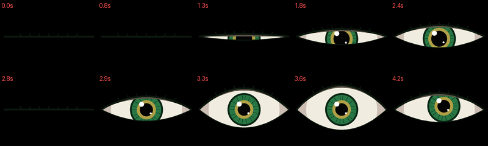
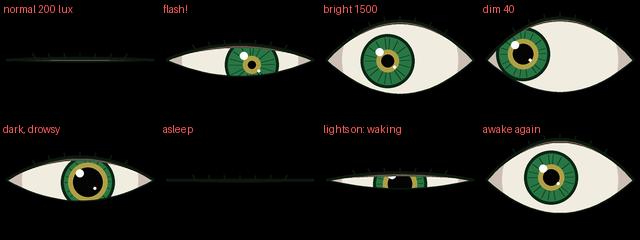

# Tufty's Roving Eye 👁️

A watchful eye for the [Pimoroni Tufty 2350](https://shop.pimoroni.com/products/tufty-2350) Badgeware badge.

It darts about, scans the room, gets suspicious, blinks, and every now and then
stares straight at whoever is reading your badge. Made for wandering a
convention floor, or keeping an eye on a classroom.


## What it does

The eye picks its own moods at random:

- **Darting:** quick glances from spot to spot
- **Scanning:** a slow sweep across the room
- **Suspicious:** narrowed lids, a shifty look one way and then the other
- **Staring:** looks right at you, pupil wide
- **Startled:** now and then, wide-eyed with a tiny pupil

It blinks on its own (sometimes twice), and the lids follow its gaze like a
real eye: looking up lifts the upper lid.

### Waking up

Each time it starts, the eye wakes up as if from a nap: it opens slowly and
drowsily, gives a few quick blinks, then opens wide and starts looking around.



### Light reactions (optional)

Plug a Pimoroni **Multi-Sensor Stick** into the I2C port on the back of the
Tufty and the eye reacts to the light around it:

- **Bright light:** the pupil shrinks
- **Sudden flash** (a phone flashlight or camera flash): it squints, blinks and the pupil snaps tiny
- **Dim light:** the pupil widens and the lids get heavy
- **Dark for a few seconds:** it dozes off, and wakes up again when the lights come back

With no sensor plugged in, it simply skips all of this.



## Buttons

| Button | What happens |
| --- | --- |
| A | Glance left |
| B | Stare at the viewer (or jump in surprise) |
| C | Glance right |

## Installing

1. Connect your Tufty to your computer with a USB-C cable.
2. Double press **RESET** on the back. A drive called **Tufty** appears.
3. Open the drive, go into the `apps` folder and make a new folder called `eye`.
4. Copy `eye/__init__.py` and `eye/icon.png` from this project into that new folder.
5. Eject the drive and press RESET. **Roving Eye** is now in the menu.

## Using it as an idle screen

You can also have the eye take over your own badge app when you haven't
pressed a button for a while, then bring your badge back with any button.

1. Copy `idle-mode/eye.py` into your badge app's folder, next to its `__init__.py`.
2. Make sure your app can import from its own folder (most badge apps already do this):

   ```python
   import sys, os
   sys.path.insert(0, "/system/apps/badge")   # your app's folder
   os.chdir("/system/apps/badge")
   import eye
   ```

3. In your `update()` function, watch the buttons and switch to the eye when idle:

   ```python
   IDLE_SECONDS = 10 * 60   # 10 minutes
   idle = False
   last_press = None

   def update():
       global idle, last_press
       now = badge.ticks
       if last_press is None:
           last_press = now

       a = badge.pressed(BUTTON_A)
       b = badge.pressed(BUTTON_B)
       c = badge.pressed(BUTTON_C)

       if a or b or c:
           last_press = now
           if idle:
               idle = False   # any button wakes the badge up
               a = b = c = False

       if not idle and now - last_press > IDLE_SECONDS * 1000:
           idle = True
           eye.reset(now)     # the eye wakes up from its nap

       if idle:
           eye.draw(now)
           return

       # ... your normal badge drawing and button handling here ...
   ```

`idle-mode/example__init__.py` is a small, complete badge app showing this in action.

## Making it your own

The settings near the top of the files are easy to change:

- **Colours:** `IRIS`, `IRIS_INNER` (the gold ring), `SCLERA` and more. `LID` is
  the colour around the eye: black by default, but forest green
  `color.rgb(34, 85, 51)` looks great too.
- **Wake-up timing:** the `WAKE_...` settings.
- **Light sensitivity:** `DARK_LUX`, `BRIGHT_LUX`, `FLASH_JUMP` and `SLEEP_AFTER_MS`.
- **Idle time:** `IDLE_SECONDS` in your badge app.

## Notes

- Written for the Tufty 2350 running Pimoroni's current Badgeware firmware.
- The light reactions use the LTR-559 light sensor on the Multi-Sensor Stick,
  read the same way as Pimoroni's own Sense app.

## License

MIT. Use it, change it, share it; just keep the license file with it.
See [LICENSE](LICENSE).

Made by Fred West.
